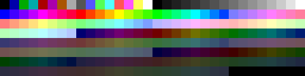
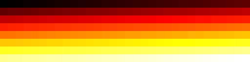

# The screen: RAM as pixels

The screen is a way of *looking at* RAM: like a video chip, it reads a block
of bytes and draws them as pixels, 60 pictures per second. Changing the
screen settings, even while a program runs, never changes a byte of RAM. The
only state the screen has of its own is the **palette chip** below.

## Settings

The bar above the screen holds:

- **Pixel format**: 1, 2 or 4 bits per pixel from a palette; 8 bits from a
  palette, as gray levels or as RGB 3-3-2; or 24-bit RGB (three bytes per pixel).
- **Palette** (palette formats only): only palettes with exactly 2^bits colors
  are offered, so 4-bit pixels get the 16-color palettes. Choosing one loads
  it into the palette chip, replacing colors the program has set.
- **Start address, width and height.**

On the screen itself:

- **Drag the picture up or down** to move the window through RAM by whole
  rows. The mouse wheel does the same.
- **Drag the corner grip** to change width and height.
- **Click a pixel** to select its byte in the RAM view.
- **Hover** to see the coordinates, the address and the value of a pixel
  (and its color, in the palette formats).

The reset button goes back to the program's `.display` line.

## Layout

Every row starts on a new byte:

`row bytes = ⌈width × bits per pixel / 8⌉`, `screen bytes = height × row bytes`.

Packed pixels are read **most-significant bits first**:

| RAM byte | 1-bit pixels | 2-bit pixels | 4-bit pixels |
| --- | --- | --- | --- |
| `0x1B` (`00011011`) | `0 0 0 1 1 0 1 1` | `0 1 2 3` | `1 11` |

So pixel (x, y) of a 16-pixel-wide 8-bit screen at `0x80` lives at
`0x80 + 16·y + x`, and on a 1-bit screen 64 pixels wide at
`screen + 8·y + x/8`, bit `7 − x mod 8`.

## `.display`

A program suggests its screen with one `.display` line. It produces no bytes:

```asm
.display 0x80, 16, 8, gray8
.display screen, 80, 60, indexed4, pico_8
```

Syntax: `.display start, width, height, format [, palette]`, with the formats
`mono`, `indexed2`, `indexed4`, `indexed8` (these use the palette chip),
`gray8`, `rgb332` and `rgb24`. Without a palette name, the palette formats
start with the default palette of their size (below). Without the line, the
screen shows 16 × 8 gray pixels at `0x80`. A screen that covers the program's own bytes is allowed — the
assembler warns, and the fire demo invites you to drag its screen over its code.

## The palette chip

In the palette formats a pixel is a color number, and the video chip looks up
its color in a palette of 256 entries: red, green and blue, 0–255 each. The
palette lives in the chip, not in RAM. It starts with the palette named in
`.display`, and a program can set every color itself through two ports:

| Port | | |
| --- | --- | --- |
| `0x13` | Palette index | chooses the color that port `0x14` changes next |
| `0x14` | Palette color | red, then green, then blue; after blue the next color is chosen |

```asm
        LDI A, 1
        OUT 0x13, A         ; color 1 is …
        LDI A, 255
        OUT 0x14, A         ; … red 255,
        LDI A, 128
        OUT 0x14, A         ; green 128,
        LDI A, 0
        OUT 0x14, A         ; blue 0: orange
```

In C: `out(PALETTE, 1); out(COLOR, 255); out(COLOR, 128); out(COLOR, 0);`.
Because the chip moves on by itself, a loop can write a whole table of colors
with one `OUT 0x13` and many `OUT 0x14` (`14-mandelbrot.asm`), or compute them
(`18-cube.c`, `22-stars.c`). This is how the VGA card of the PC worked.

A changed color changes every pixel with that number at once, without writing
a byte of RAM. Shifting the colors every frame makes still pictures flow:
**color cycling**, as in `23-color-cycling.c`. The device bar shows the color
written last and how many colors the program has set. Stepping back undoes
palette writes, too.

## Vsync: when the screen takes its picture

While a program runs, the screen takes its picture of RAM and the palette at
the start of every frame, 60 times per second of machine time; in between it
shows the last one. Reading port `0x04` (**Vsync**, in C `in(VSYNC)`) waits
for that moment: the CPU idles until then and gets the timer value.

```c
for (;;) {
    in(VSYNC);                  // the screen has just taken its picture
    change_colors();            // all changes appear together in the next one
    move_things();
}
```

Changes made right after vsync appear together in the next picture, never
half done, and the program runs at 60 steps per second at any clock. A
program that does not wait can be caught in the middle of drawing, which is
what page flipping (see [Devices](devices.md)) is for. While paused or
stepping, the screen shows RAM as it is right now.

## Predefined palettes

`1bit_monitor_glow` · 2 colors


`cga_palette_1_high` · 4 colors


`color_graphics_adapter` · 16 colors


`pico_8` · 16 colors


`sweetie_16` · 16 colors


`vga` · 256 colors



`fire_256` · 256 colors



The first palette of each size is the default: `1bit_monitor_glow`,
`cga_palette_1_high`, `color_graphics_adapter` and `vga`. All but `fire_256`
come from [PixelRAM](https://github.com/specht/pixelram/blob/main/tools/palettes.yaml)
with their original color order; `fire_256` runs from black over red, orange
and yellow to white, for heat values (`09-fire.asm`, `15-inferno.asm`,
`21-life.c`). The Screen page of the Documentation dialog shows the same
palettes; hover a color to see its number.

## How many pixels fit?

| Screen | Pixels | Bytes |
| --- | ---: | ---: |
| 32 × 16, 1 bit | 512 | 64 |
| 16 × 16, 2 bits | 256 | 64 |
| 16 × 8, 4 bits | 128 | 64 |
| 8 × 8, 8 bits | 64 | 64 |
| 80 × 60, 4 bits (8X only) | 4800 | 2400 |
